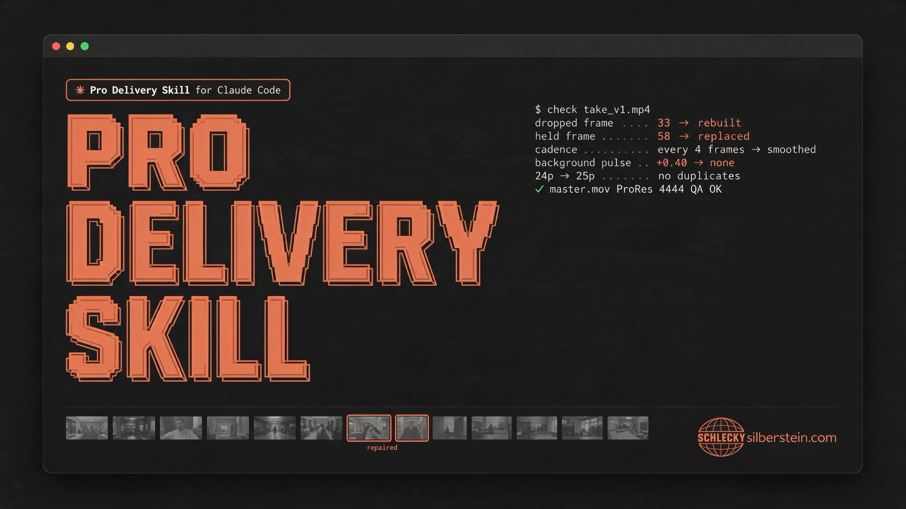

# Pro Delivery Skill for Claude Code



Turn AI-generated clips (Seedance, Dreamina, Kling, Veo, Magnific …) into clean master files for client hand-off: no frame stutter, no freezes, no dropped or duplicate frames, no background pulse, correct frame rate, sound in sync.

Tested in real AI-to-TV workflows: generated shots that went into a TV production, through a post house, and were accepted.

## Why you need it

**Always repair Seedance files before you send them to a client.**

A Seedance clip can look perfect in the browser and still fail the moment an editor, a colourist or a post house steps through it frame by frame. The problem is rarely the image. It is time: frames that are held and then jump, frames that are missing or doubled, a rhythm that repeats every few frames, a standing background that refreshes itself, a first frame that does not move.

This is not a guess. ByteDance itself treats it as a known problem. Its cloud arm BytePlus offers a dedicated repair tool, **Video Smoothness Enhance** (AI MediaKit), in its own ComfyUI extension. It detects and repairs exactly this: periodic stutter, where the motion rhythm jumps, and duplicate frames. BytePlus's quality-enhancement material for Seedance 2.5 also names texture flicker and edge jitter as issues to fix. Nobody builds a repair tool for a problem that does not exist.

## What goes wrong

- **Stutter and dropped frames.** The generator skips an image. Motion jumps by a double step.
- **Holds and duplicates.** A frame stays for two frames, then the motion catches up.
- **Generator cadence.** A slightly larger step every 4 frames, through the whole clip. No single frame looks wrong, but the clip feels "retimed" and restless.
- **Background pulse.** With a locked camera the standing image is refreshed every few frames. Streets, walls and skies seem to breathe or jump.
- **Start image as frame 0.** The still you uploaded comes back as the first frame. The motion starts one frame late, or a detail swaps.
- **Hard stop at the end.** The motion ends abruptly and the last frames hold. It reads as a freeze.
- **Irregular timestamps.** Downloads often carry a 60 fps time base for 24 frames per second. Editing software and converters then insert or drop frames on their own.
- **Wrong frame-rate conversion.** 24p pushed to 25p by a converter doubles one frame every second. That is exactly the "frame drop" a client will report.
- **Morphing details.** An object changes shape mid-shot, or a detail from a reference video appears that should not be there. No measurement finds this; only careful viewing does.

## Why a repair tool alone is not enough

A repair tool fixes what it detects. It does not tell you whether the result is now clean, whether the sound is still in sync, whether the first and last frames are usable, or whether the background still pulses. It also cannot check the clip against the timing of an existing shot.

## What the skill does

1. **Measures every frame** at full resolution, frame-exact, without the timestamp trap.
2. **Separates errors from real motion.** A blink, a slowing car or a cut stays as it is.
3. **Repairs as little as possible.** Missing and held frames are rebuilt between their real neighbours, the background pulse is calmed while everything that moves stays original, and the timing can follow a reference clip. Real frames stay untouched.
4. **Writes one clean master** (ProRes 4444 or a viewing copy) with correct frame rate and sound in sync.
5. **Checks the master again.** Every remaining hint is named and explained.

The result is a file you can hand to a client without the next mail being "We can't use this!"

## Install

```bash
git clone https://github.com/brandymessage-cmyk/pro-delivery-skill.git
cp -R pro-delivery-skill/skill ~/.claude/skills/pro-delivery-skill
pip install -r ~/.claude/skills/pro-delivery-skill/scripts/requirements.txt
```

Or download the ZIP from this page and copy the `skill` folder to `~/.claude/skills/pro-delivery-skill`.

Requirements:

- `ffmpeg` and `ffprobe`
- Python 3 with `numpy`, `opencv-python`, `pillow`
- for repairs: [rife-ncnn-vulkan](https://github.com/nihui/rife-ncnn-vulkan) with the model `rife-v4.6`; set its folder with `export RIFE_DIR=/path/to/rife-ncnn-vulkan`

No Nuke, no Resolve, no special software.

## Use

In Claude Code, just describe the problem:

> This Seedance clip stutters, make a clean 25p master with sound: take.mp4

Claude measures every frame, repairs only what is broken and checks the finished file again. The scripts in `skill/scripts/` also run on their own; see `skill/SKILL.md` for every command.

## Limits

- The skill does not change content, colour or sharpness.
- Morphing objects and wrong details cannot be measured. The skill points them out; fix them by regenerating or patching.
- Background calming and protected interpolation assume a locked camera.
- A 4K clip of about 120 frames takes roughly 20–30 minutes for pulse removal and retime on an Apple Silicon Mac.

## License

MIT, see [LICENSE](LICENSE).
